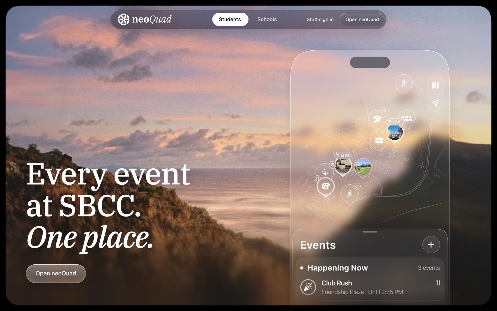
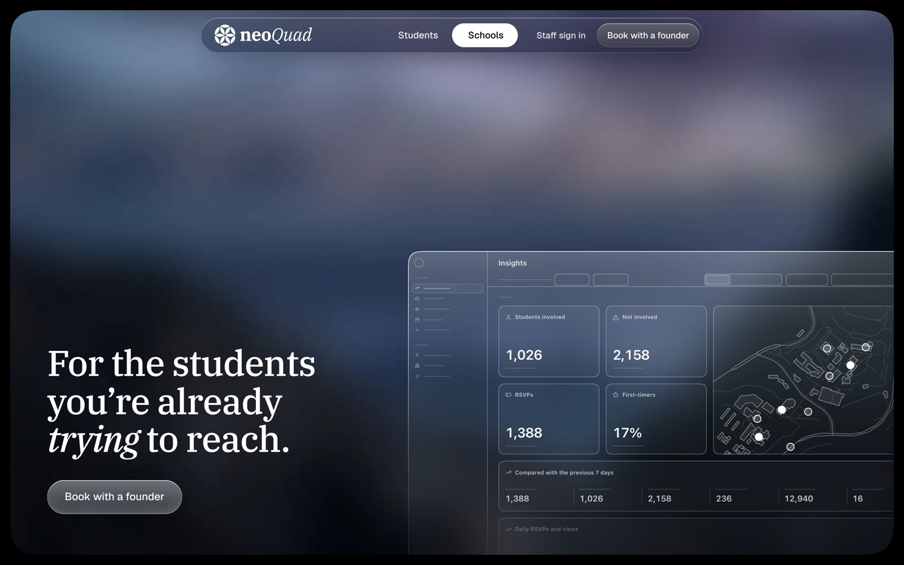

# neoQuad landing

The neoQuad website: one page for students and one for schools.





## Run the site

```bash
npm install
npm run dev
```

The site runs at http://localhost:4321. To build it, run `npm run build`; the static site goes to `dist/`, and Vercel deploys it.

## Where to change things

| To change | Edit |
| --- | --- |
| Links (App Store, web app, staff sign-in, booking, email) | `src/config.ts` |
| Colors, type, spacing and motion | `src/styles/global.css` |
| The Students and Schools pages | `src/pages/index.astro` and `src/pages/schools.astro` |
| The privacy policy and terms | `src/content/legal/` |
| Events and places shown in the app drawings | `src/components/app/sample.ts` |
